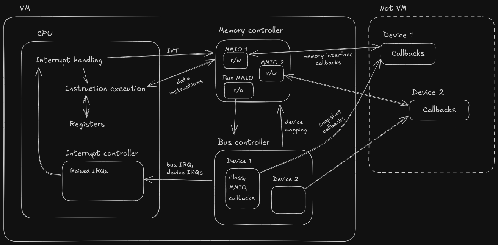

fcvm – a virtual machine for the Minecraft mod Fennel Computers.

Features:

* Small instruction set (37 instructions, [71 opcodes][opcodes]).
* Single address space with memory-mapped devices.
* Interrupts provided for the devices.
* Device enumeration using a memory-mapped bus controller.

<picture>
  <source media="(prefers-color-scheme: light)" srcset="./docs/images/Architecture-overview-light.png">
  
</picture>

[opcodes]: src/cpu/instr_descs.c#L8-L84
